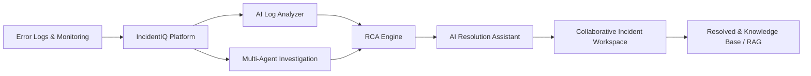

# IncidentIQ (AgentOps)

> **Centralized AI-Powered Incident Management & Collaborative Investigation Platform**

Traditional software development and incident management often involve fragmented workflows across error monitoring tools, log analysis systems, debugging environments, and team communication platforms. **IncidentIQ** is a centralized, AI-powered incident management and collaborative investigation platform that integrates intelligent debugging, automated root cause analysis, and multi-agent AI assistance into a unified workspace.

---

## 🎯 Main Aim & Core Objectives

IncidentIQ bridges the gap between raw production errors and rapid resolution by streamlining the entire incident lifecycle into an automated, collaborative, and AI-assisted workflow.



---

## 🚀 Key Functional Modules

### 1. Incident Management Dashboard
- Centralized dashboard for creating, tracking, prioritizing, and managing software incidents.
- Configurable severity levels (P1-P4), lifecycle statuses (Open, Investigating, Mitigated, Resolved).
- Real-time incident assignment, tagging, and SLA tracking.

### 2. AI Log Analyzer
- Ingestion and processing of application logs, stack traces, and error reports.
- Automated anomaly detection, recurring failure clustering, and actionable debugging insights.

### 3. Root Cause Analysis (RCA) Engine
- Evidence-based analysis correlating incident details, error patterns, execution traces, and code context.
- Generates transparent, verifiable explanations of why an incident occurred.

### 4. Multi-Agent Investigation System
- Multi-agent architecture orchestrated using **LangGraph** and **LangChain**:
  - **Log Analysis Agent:** Parses and extracts critical anomalies from logs.
  - **Error Diagnosis Agent:** Classifies errors and links them to runtime conditions.
  - **Code Investigation Agent:** Inspects relevant repository files and git history.
  - **RCA Agent:** Synthesizes observations into root cause hypotheses.
  - **Remediation Agent:** Formulates concrete fix proposals.

### 5. Collaborative Incident Workspace
- Shared live investigation environment for engineering teams.
- Activity timelines, collaborative investigation notes, markdown comments, and task assignments.

### 6. AI-Powered Resolution Assistant
- Context-aware troubleshooting playbooks, code patch suggestions, and remediation workflows.
- Learns from both live runtime diagnostics and historical post-mortems.

### 7. Incident Analytics & Monitoring
- Interactive dashboard visualizing incident volume, MTTA / MTTR metrics, severity distributions, and agent execution performance.

### 8. Knowledge Retrieval System (RAG Pipeline)
- Retrieval-Augmented Generation using embeddings and vector databases.
- Surfaces relevant internal runbooks, previous resolved post-mortems, and codebase context to ensure grounded, hallucination-free AI responses.

---

## 🛠️ Technology Stack

| Layer | Technologies |
|---|---|
| **Backend Service** | Java 21+, Spring Boot, Spring Security (JWT), Spring Data JPA |
| **Persistence / ORM** | MySQL / PostgreSQL, Hibernate |
| **AI Orchestration** | Multi-Agent Architecture, LangGraph, LangChain, Vector DB (RAG) |
| **Security** | Stateless JWT Authentication, BCrypt Password Encryption, Role-Based Access Control |
| **Documentation & API** | RESTful APIs, OpenAPI / Swagger |

---

## 📁 Repository Structure

```
AgentOps/
├── README.md                          # Project overview & mission statement
├── PROJECT_SPEC.md                    # Detailed architectural and domain specification
└── agentops/                          # Spring Boot Backend Service
    ├── pom.xml                        # Maven configuration & dependencies
    └── src/main/java/com/agentops/
        ├── Controllers/               # REST API endpoints (Auth, Incidents, Agents)
        ├── Services/                  # Business & orchestration logic
        ├── Repositories/              # Spring Data JPA repositories
        ├── Models/                    # JPA entities (User, Incident, LogTrace, etc.)
        ├── DTO/                       # Data transfer objects & payload contracts
        ├── Security/                  # JWT filters, security configurations, auth provider
        └── Config/                    # App beans and configurations
```

---

## 🚦 Getting Started

### Prerequisites
- JDK 21+
- MySQL 8.0+
- Maven 3.9+

### Configuration
Update [`agentops/src/main/resources/application.properties`](file:///d:/Mohan/AgentOps/agentops/src/main/resources/application.properties):
```properties
spring.datasource.url=jdbc:mysql://localhost:3306/agentops_db
spring.datasource.username=YOUR_DB_USERNAME
spring.datasource.password=YOUR_DB_PASSWORD
spring.jpa.hibernate.ddl-auto=update
jwt.secret=YOUR_64_CHAR_HEX_SECRET_KEY
```

### Running the Application
```bash
cd agentops
./mvnw clean spring-boot:run
```

